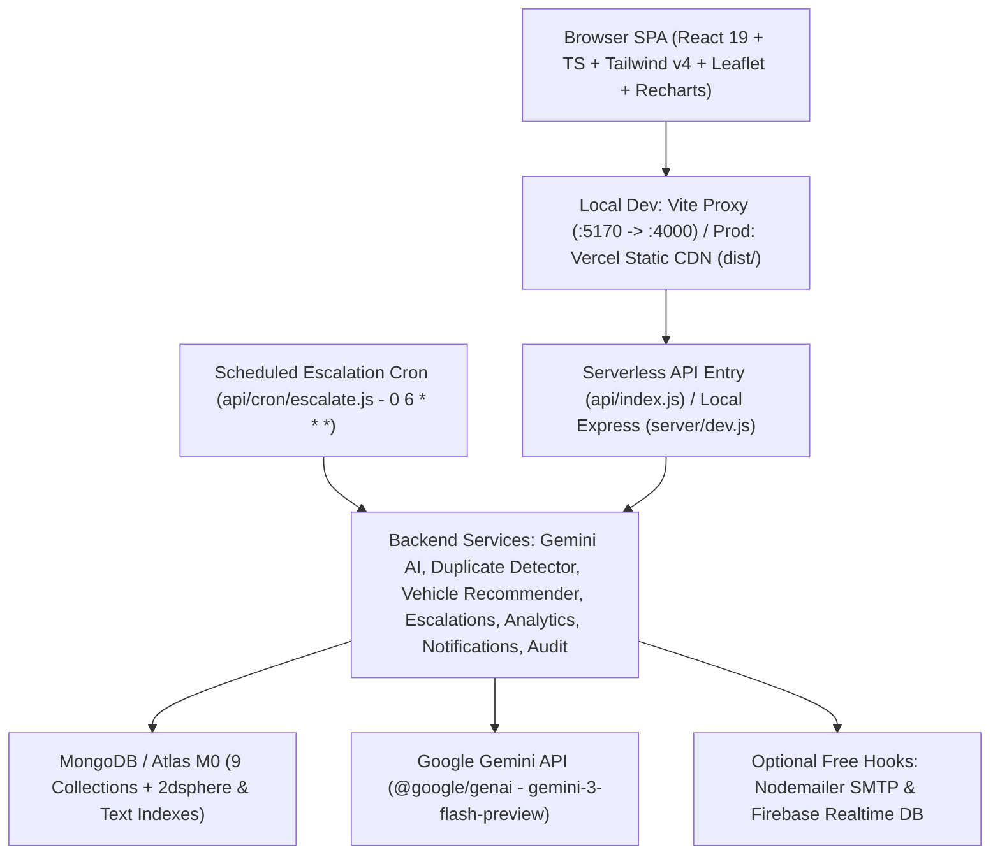
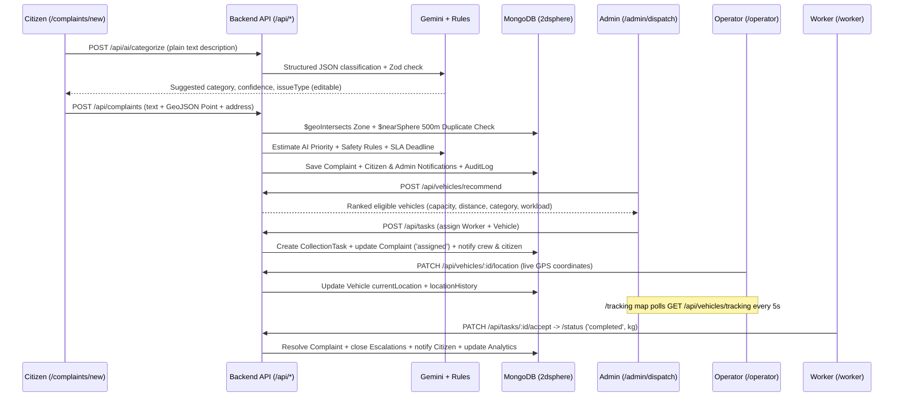

# CivicClean SWM — Complete Project Guide, Workflow & Live Demo Handbook

> **Consolidated Reference Guide** for the **Smart Waste Management System** (B.Tech Full Stack Development End-Semester Project).  
> Covers system architecture, workspace layout, local & serverless execution, end-to-end role workflows, **live GPS tracking**, Gemini AI guardrails, and demo/troubleshooting checklists.

---

## 1. Project Overview & Workspace Map

CivicClean SWM helps municipalities manage citizen waste complaints, sanitation workers, collection vehicles, GeoJSON collection zones, deterministic vehicle allocation, live GPS tracking, automated SLA escalations, and real-time analytics.

```text
Smart-Waste-Management/
├── PROJECT_GUIDE.md                          # This complete handbook
├── README.md                                 # Root workspace index
├── docs/                                     # Canonical DB schema, API contracts, Deployment, Testing & SimilarWeb docs
├── Person-1-Citizen-Management/              # Developer 1: Auth, Citizen Portal, Complaints, Gemini Categorizer, Duplicates, Chatbot
├── Person-2-Collection-Fleet-Management/     # Developer 2: Workers, Fleet, Tasks, Zones, Vehicle Recommendation, Live GPS Map
├── Person-3-Administration-Analytics/        # Developer 3: Admin Dashboard, Gemini Priority, Notifications, Escalations, Recharts, Hotspots, Audit
└── Smart-Waste-Management-Full-Application/  # Unified Production App integrating all 3 developers' modules
```

| Workspace | Owner | Frontend Port | Local API Port | Test DB (`127.0.0.1:27017`) |
| --- | --- | --- | --- | --- |
| `Person-1-Citizen-Management` | Person 1 | `5171` | `4001` | `swm_p1_test` |
| `Person-2-Collection-Fleet-Management` | Person 2 | `5172` | `4002` | `swm_p2_test` |
| `Person-3-Administration-Analytics` | Person 3 | `5173` | `4003` | `swm_p3_test` |
| `Smart-Waste-Management-Full-Application` | Integrated Team | `5170` | `4000` | `swm_full_test` (seed DB: `swm_demo` / `swm_full`) |

### Technology Stack
- **Frontend**: React 19, TypeScript, Vite, Tailwind CSS v4, React Router v7, Axios, Leaflet + React-Leaflet (OpenStreetMap), Recharts v3, Lucide React.
- **Backend**: Node.js, Express.js, Mongoose 8, Zod, bcryptjs, jsonwebtoken, `@google/genai`, Nodemailer.
- **Database**: MongoDB (GeoJSON `Point`/`Polygon`, `2dsphere` geospatial indexes, aggregation pipelines; Atlas M0 Free Tier ready).
- **Hosting & AI**: Vercel Hobby Free Plan (serverless functions + daily cron), Google Gemini API (`gemini-3-flash-preview`, server-side only).

---

## 2. System Architecture & End-to-End Sequence

### Container & Runtime Architecture



### Complete Cross-Module Operational Lifecycle



---

## 3. How the Project Runs (Local vs. Vercel Serverless)

### Local Development (`npm run dev`)
1. `concurrently` launches two processes inside `Smart-Waste-Management-Full-Application`:
   - **Backend (`server/dev.js`)**: Loads `.env`, mounts `server/app.js` on `http://127.0.0.1:4000`, and connects to MongoDB (`MONGODB_URI` in `.env`, defaulting to `mongodb://127.0.0.1:27017/swm_full`).
   - **Frontend (`vite`)**: Serves `client/` on `http://localhost:5170` and proxies every `/api/*` call to `http://127.0.0.1:4000`.
2. Notice `.env` vs `.env.example`:
   - `.env` holds your real local secrets (`GEMINI_API_KEY`, `JWT_SECRET`, `MONGODB_URI`) and is gitignored.
   - `.env.example` stays blank as a template so API keys are never accidentally committed.

### Production on Vercel Hobby Free Plan
1. `npm run build` compiles the React SPA into `dist/`.
2. `vercel.json` routes `/api/cron/escalate` to `api/cron/escalate.js` (daily Hobby cron `0 6 * * *`), all other `/api/(.*)` traffic to the single Express serverless entry `api/index.js` (staying well under Vercel Hobby's 12-function limit), and SPA routes to `/index.html`.
3. `server/shared/config/db.js` caches the Mongoose connection on `globalThis.__swmMongooseCache` so warm serverless invocations reuse connections without exhausting MongoDB Atlas M0's free-tier pool.
4. Real-time updates use structured polling (`usePolling` hook: 5s on live map tracking, 12s on notification badges) instead of persistent Socket.IO servers, which cannot run on serverless functions.

---

## 4. Quick Start & `.env` Setup

Ensure local MongoDB is running (`127.0.0.1:27017`) or set an Atlas M0 URI in `.env`.

```powershell
cd "c:\Users\anees\Desktop\Sem 5\Full Stack Dev\Endsem Hackathon\Smart-Waste-Management\Smart-Waste-Management-Full-Application"
npm install        # Already installed if set up previously
npm run seed       # Optional: populates demo users, 3 GeoJSON zones, 4 vehicles, complaints & tasks
npm run dev        # Starts API (:4000) + Frontend (:5170)
```

Open **`http://localhost:5170`**.

### Seeded Demo Accounts (Password for all: `Demo@1234`)

| Role | Email | Default Landing Route |
| --- | --- | --- |
| **Citizen** | `citizen@civicclean.org` | `/citizen` |
| **Municipal Admin** | `admin@civicclean.org` | `/admin` |
| **Vehicle Operator** | `operator@civicclean.org` | `/operator` |
| **Sanitation Worker** | `worker@civicclean.org` | `/worker` |

*(You can also create brand-new accounts for any role on `/register`.)*

---

## 5. Complete Role-by-Role Workflow & Live Demo Script

To demonstrate the entire integrated system in a live viva or evaluation, open **4 browser windows/tabs** (or incognito profiles so each tab keeps its own JWT in `localStorage`) — one per role:

### Step 1: Citizen Files a Complaint (`citizen@civicclean.org`)
1. Open **Submit Complaint** (`/complaints/new`).
2. Enter a **Title** and plain-text **Description** (e.g., *"Leaking car batteries and chemical paint cans dumped near school gate"*).
3. Click **Gemini AI Suggest Category** (`POST /api/ai/categorize`) -> Gemini returns `{ suggestedCategory: "hazardous", confidence, issueType, summary, keywords }`. You can accept or change the category.
4. Click anywhere on the Leaflet map (or click **Use My GPS**) and fill in the **Address**.
5. Optionally click **Check Duplicates** (`POST /api/complaints/check-duplicates`) to verify nearby `$nearSphere` (500m) + lexical/Gemini similarity warnings (submissions are never auto-blocked).
6. Click **Submit Waste Complaint**.
   - **What happens automatically**: Zone matched via `$geoIntersects`, AI Priority + SLA deadline computed, Citizen & Admin notified, `AuditLog` recorded.
7. Visit **Waste Assistant** (`/chatbot`) to ask disposal questions and **My Complaints** (`/complaints`) to inspect the live status timeline.

### Step 2: Admin Triages, Estimates Priority & Dispatches (`admin@civicclean.org`)
1. Open **Command Center** (`/admin`) to view KPIs, then go to **Complaints & Dispatch** (`/admin/dispatch`).
2. Locate the newly submitted complaint:
   - Click **AI Priority** (`POST /api/ai/priority`) or manually change the priority dropdown (triggers override modal & audit log).
   - Click **Dispatch** -> runs `POST /api/vehicles/recommend`.
3. Inspect the ranked vehicle scores (evaluated deterministically by availability, remaining capacity `>= estimatedWeightKg`, waste category clearance e.g. `hazmat_van` for hazardous waste, Haversine distance, and active workload) plus Gemini's summary explanation.
4. Select a **Worker** + recommended **Vehicle** and click **Confirm Task Dispatch** (`POST /api/tasks`).
   - Complaint status moves to `assigned`; notifications go to Worker, Vehicle Operator, and Citizen.

### Step 3: Vehicle Operator Broadcasts Live GPS (`operator@civicclean.org`)
1. Open **Operator GPS Console** (`/operator`) to view assigned vehicle telemetry and dispatched route tasks.
2. Adjust Longitude/Latitude (e.g., nudge coordinates by `+0.002`) and click **Update Coordinates** (or click **Device GPS**).
3. Switch to **Live Fleet Map** (`/tracking`) to see the updated pin position on OpenStreetMap.

### Step 4: Sanitation Worker Executes & Resolves (`worker@civicclean.org`)
1. Open **Worker Console** (`/worker`).
2. Toggle availability (`available`, `on_duty`, `on_break`, `off_duty`).
3. On the newly dispatched task, click **Accept** (`PATCH /api/tasks/:id/accept`) -> **En Route** -> **Start Collection** -> enter collected weight (kg) and click **Complete** (`PATCH /api/tasks/:id/status`).
4. **Result across the system**:
   - Complaint status becomes `resolved`.
   - Citizen receives a `task_completed` notification on their bell/Notifications page.
   - Worker's completed count and Vehicle's `totalTripsCompleted` / `totalWasteCollectedKg` increment.

### Step 5: Admin Analytics, Hotspots, Escalations & Reports (`admin@civicclean.org`)
1. **Analytics Dashboard** (`/analytics`): View Recharts Area/Pie/Bar charts powered by live MongoDB aggregation pipelines.
2. **Geospatial Hotspots** (`/hotspots`): Inspect spatial concentration circles overlaid on GeoJSON collection zone polygons.
3. **Escalations & SLA** (`/escalations`): Click **Run Escalation Scan** (`POST /api/admin/escalations/run`). Seeded complaint `SWM-2026-D001` is pre-set past its SLA deadline so it escalates immediately; clicking a second time demonstrates the 6-hour anti-duplicate cooldown (`0` repeat escalations).
4. **Security & Audit** (`/audit`) & **Users & Reports** (`/reports`): Inspect immutable audit events (including logins, priority overrides, task dispatches, and RBAC denials) and export `civicclean-full-report.csv`.

---

## 6. How Live GPS Tracking Works & Where to Receive It

**Where you send GPS updates (Producer):**
- **Route**: `/operator` (**Operator GPS Console**, logged in as `vehicle_operator` or `admin`)
- **API**: `PATCH /api/vehicles/:id/location` with `{ coordinates: [longitude, latitude], speedKmh, heading }`
- **Database Effect**: Updates `Vehicle.currentLocation` (`2dsphere`-indexed GeoJSON `Point`), `locationUpdatedAt`, and appends to `Vehicle.locationHistory` (capped at 50 points).

**Where you receive/view Live Tracking (Consumers):**
- **Admin Live Map**: `/tracking` (**Live GPS Map** in Admin sidebar)
- **Operator Live Map**: `/tracking` (**Live Fleet Map** in Operator sidebar)
- **API**: `GET /api/vehicles/tracking` (returns active vehicles, open complaints, active tasks, and GeoJSON zone boundaries).
- **Update Cadence**: `LiveTrackingMapPage.tsx` uses `usePolling(load, 5000, true)` to automatically refresh map markers every **5 seconds** without needing WebSockets.

**Quick 2-Window Live Tracking Demo:**
1. Window A (Admin): Open `http://localhost:5170/tracking`.
2. Window B (Operator): Open `http://localhost:5170/operator`, change Latitude/Longitude slightly (e.g., `77.5960`, `12.9740`), and click **Update Coordinates**.
3. Within 5 seconds, Window A's blue **`V`** vehicle marker moves automatically on the OpenStreetMap canvas.

---

## 7. Gemini AI Integration & Safety Guardrails

- **SDK & Model**: Backend-only `@google/genai` using `process.env.GEMINI_API_KEY` and `gemini-3-flash-preview`. Secrets are never exposed to `client/`.
- **Structured Outputs + Zod**: Categorization, Priority Estimation, and Duplicate Context return strict JSON validated via Zod schemas before touching application state.
- **Deterministic Fallbacks**: If `GEMINI_API_KEY` is blank, rate-limited, or times out (>7.5s), rule-based fallback engines execute seamlessly so no user workflow ever blocks.
- **Guardrails**:
  - Citizens can always edit AI-suggested categories.
  - Duplicate detection warns citizens and flags complaints, **never auto-rejecting**.
  - Hazardous/medical complaints are clamped to minimum `high` priority regardless of AI output; Admin overrides always take precedence and log an `AuditLog`.
  - Vehicle recommendation ranking is 100% deterministic; Gemini only generates an optional human-readable summary.

---

## 8. Companion Documentation

- **Database Schema (9 Collections & Indexes)**: [docs/DATABASE_SCHEMA.md](./docs/DATABASE_SCHEMA.md)
- **REST API Contracts**: [docs/API_CONTRACTS.md](./docs/API_CONTRACTS.md)
- **OpenAPI 3.0 Spec**: [Smart-Waste-Management-Full-Application/docs/openapi.json](./Smart-Waste-Management-Full-Application/docs/openapi.json)
- **Testing Matrix**: [docs/TESTING.md](./docs/TESTING.md)
- **Vercel Free-Tier Deployment Guide**: [docs/DEPLOYMENT.md](./docs/DEPLOYMENT.md)
- **SimilarWeb Benchmark Analysis**: [docs/SIMILARWEB_ANALYSIS.md](./docs/SIMILARWEB_ANALYSIS.md)

---

## 9. Troubleshooting FAQ

| Issue | Cause | Fix |
| --- | --- | --- |
| Gemini responses show `fallbackUsed: true` | `GEMINI_API_KEY` was placed in `.env.example` instead of `.env`, or dev server wasn't restarted after editing `.env` | Put `GEMINI_API_KEY=...` in `.env` (keep `.env.example` empty) and restart `npm run dev` |
| `ECONNREFUSED ::1:27017` on Windows | Node resolved `localhost` to IPv6 `::1`, while local `mongod` listens on IPv4 `127.0.0.1` | Always use `mongodb://127.0.0.1:27017/...` in `.env` |
| `seed` script runs, where is demo data? | `seed.js` defaults to `swm_demo` unless `MONGODB_URI` is set in `.env` | Copy `.env.example` to `.env` before running `npm run seed` so both `seed` and `dev` use the same DB |
| Map pins missing in production | Default Leaflet PNG icon paths break under Vite bundling | Already solved via custom SVG `L.divIcon` markers |
| Atlas connection fails on Vercel | MongoDB Atlas IP Access List blocks dynamic serverless IPs | Allow `0.0.0.0/0` in MongoDB Atlas **Network Access** |
