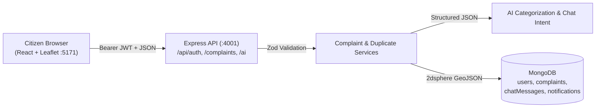

# Person 1 — Citizen & Complaint Management (`CivicClean SWM`)

> **Owner**: Developer 1  
> **Workspace**: `Person-1-Citizen-Management`  
> **Local URLs**: Frontend `http://localhost:5171` · Backend API `http://127.0.0.1:4001`  
> **Primary User Role**: `citizen` (also supports `admin` viewing/filing)

This workspace implements the complete **citizen-facing portal** of the CivicClean Smart Waste Management System: secure authentication, text-first waste complaint submission with GPS map pinning, AI waste categorization, geospatial duplicate detection, complaint history & tracking, notifications, and a persistent action-capable Citizen Waste Assistant chatbot.

---

## 1. Feature-by-Feature Guide (Access & Tech Stack)

| # | Feature | How to Access (UI Path & Role) | Backend API Endpoint(s) | Tech Stack & Implementation Details |
| --- | --- | --- | --- | --- |
| **1** | **Authentication, Registration & Profile** | Go to `/register` to create an account or `/login` to sign in. Manage name, phone, and home address at **Sidebar → Profile** (`/profile`). | `POST /api/auth/register`<br>`POST /api/auth/login`<br>`GET /api/auth/me`<br>`PATCH /api/auth/profile` | **Express.js**, **JWT (`jsonwebtoken`)** Bearer tokens, **`bcryptjs`** password hashing (10 salt rounds), **Zod** request validation, **React Context (`AuthContext`)** + Axios interceptors, **MongoDB (`users`)**. |
| **2** | **Citizen Dashboard** | Auto-opens after login at **Sidebar → Citizen Dashboard** (`/dashboard`). Shows total, open, in-progress, and resolved complaints plus quick actions. | `GET /api/complaints`<br>`GET /api/notifications` | **React 19 + TypeScript**, **Tailwind CSS v4**, **Lucide React** icons, **Axios**, MongoDB filtered queries (`citizenId: req.user._id`). |
| **3** | **Text-First Waste Complaint Submission & GPS Pinning** | Click **Sidebar → Submit Complaint** (`/complaints/new`). Enter title, plain-English description, weight, street address, and click the interactive map or **"Use My GPS"**. | `POST /api/complaints` | **React-Leaflet v5 + Leaflet 1.9** (`MapContainer`, `Marker`, `useMapEvents`), **Browser Geolocation API**, **MongoDB GeoJSON `Point`** with **`2dsphere`** geospatial index (`complaints.location`), automatic zone matching via `$geoIntersects`. |
| **4** | **AI Waste Categorization** | On `/complaints/new`, write a description and click **"AI Suggest Category"**. Review the suggested waste category, confidence score, and summary (or override manually). | `POST /api/ai/categorize` | Backend-only **`@google/genai`** SDK (`gemini-3-flash-preview`) returning strict JSON validated with **Zod** (`suggestedCategory`, `confidence`, `issueType`, `summary`, `keywords`) + deterministic keyword fallback when offline/rate-limited. |
| **5** | **Duplicate Complaint Detection** | On `/complaints/new`, click **"Check Nearby Duplicates"** (also runs automatically on submit). Warns about nearby matching open complaints without blocking submission. | `POST /api/complaints/check-duplicates` | **MongoDB `$nearSphere` / `$geoWithin`** (500 m radius) + **Jaccard lexical token similarity** + optional AI contextual comparison. Saves `duplicateAnalysis` metadata on each complaint. |
| **6** | **Complaint History & Status Timeline** | Click **Sidebar → My Complaints** (`/complaints`). Select any complaint to inspect its full `statusHistory` audit trail (`submitted → assigned → in_progress → resolved`). | `GET /api/complaints`<br>`GET /api/complaints/:id` | **React 19**, **Tailwind CSS v4**, **Mongoose** populated queries, status badges, search & filter query parameters. |
| **7** | **Action-Capable Citizen Waste Assistant Chatbot** | Click **Sidebar → Waste Assistant** (`/chatbot`). Use quick prompts or type naturally to check live complaint statuses, submit a complaint directly from chat (with optional **"Attach GPS"**), or ask disposal questions. Chats persist across refreshes. | `GET /api/ai/chat/history`<br>`POST /api/ai/chat`<br>`DELETE /api/ai/chat/history` | **MongoDB (`chatMessages`)** persistence, structured **Zod** intent schema (`check_status`, `submit_complaint`, `general_help`), reusable `complaintService.js` (`createComplaintRecord`), **`@google/genai`** + deterministic fallback. |
| **8** | **Notifications Viewer** | Click **Sidebar → Notifications** (`/notifications`). Displays unread badge count, complaint confirmations, and status alerts with mark-as-read controls. | `GET /api/notifications`<br>`PATCH /api/notifications/:id/read`<br>`PATCH /api/notifications/read-all` | **MongoDB (`notifications`)**, `notificationService.js`, React state + unread counter in `AppShell`. |

---

## 2. Core Tech Stack Summary

- **Frontend**: React 19, TypeScript 5.8, Vite 6/7, Tailwind CSS v4, React Router v7, Axios, Leaflet + React-Leaflet v5, Lucide React
- **Backend**: Node.js (ESM), Express.js 4, Mongoose 8, Zod 3, `bcryptjs`, `jsonwebtoken`, `cors`, `dotenv`
- **Database**: MongoDB (local `127.0.0.1:27017` or MongoDB Atlas M0 Free Tier) with `2dsphere` GeoJSON indexes
- **AI Engine**: `@google/genai` (server-side only, never exposed to client) with Zod schema enforcement and deterministic fallback
- **Testing & Deployment**: Vitest + Supertest (`tests/person1.test.js`), Vercel Hobby Free-Plan serverless (`api/index.js`)

---

## 3. Data Flow Architecture



---

## 4. Quick Start & Commands

```bash
cd Person-1-Citizen-Management
cp .env.example .env       # Configure MONGODB_URI, JWT_SECRET, and optional GEMINI_API_KEY
npm install
npm run dev                # Starts API (:4001) + Vite frontend (:5171) concurrently
```

### Verification Commands

```bash
npm run typecheck          # TypeScript strict check
npm run build              # Production bundle -> dist/
npm test                   # Vitest + Supertest integration suite (swm_p1_test)
```

---

## 5. Viva / Demo Walkthrough (2 Minutes)

1. Open `http://localhost:5171/register`, create a citizen account (or sign in), and show the **Citizen Dashboard**.
2. Open **Submit Complaint** (`/complaints/new`), type `"Overflowing rotting food and plastic bags near MG Road bus stop"`, click **AI Suggest Category**, pin the location on the **Leaflet map**, click **Check Nearby Duplicates**, and submit.
3. Open **Waste Assistant** (`/chatbot`), ask `"Check status of my complaints"` to show live DB lookup, then file a second complaint directly via chat and refresh the page to prove MongoDB chat persistence.
4. Show **My Complaints** (`/complaints`) and **Notifications** (`/notifications`) updating with the newly created records.

---

## Related Docs
- [Person 1 Module Guide](./docs/PERSON1_MODULE_GUIDE.md)
- [Shared Database Schema](./docs/DATABASE_SCHEMA.md)
- [Shared API Contracts](./docs/API_CONTRACTS.md)
