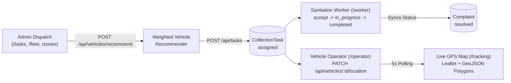

# Person 2 — Collection, Workers & Fleet Management (`CivicClean SWM`)

> **Owner**: Developer 2  
> **Workspace**: `Person-2-Collection-Fleet-Management`  
> **Local URLs**: Frontend `http://localhost:5172` · Backend API `http://127.0.0.1:4002`  
> **Primary User Roles**: `admin`, `worker` (Sanitation Worker), `vehicle_operator` (Driver/Operator)

This workspace implements the **field operations and fleet logistics engine** of CivicClean SWM: sanitation worker management, fleet registry, GeoJSON ward/collection zones, the deterministic **Intelligent Vehicle Recommendation Algorithm**, collection task lifecycle orchestration, and live GPS fleet tracking on Leaflet maps.

---

## 1. Feature-by-Feature Guide (Access & Tech Stack)

| # | Feature | How to Access (UI Path & Role) | Backend API Endpoint(s) | Tech Stack & Implementation Details |
| --- | --- | --- | --- | --- |
| **1** | **Sanitation Worker Console** | Sign in as a `worker` → **Sidebar → Worker Console** (`/worker`). Toggle availability (`available`, `on_duty`, `on_break`, `off_duty`), accept or reject assigned tasks, mark `en_route` / `in_progress`, and complete collections with collected weight (kg) & notes. | `GET /api/workers/me`<br>`PATCH /api/workers/me/availability`<br>`GET /api/tasks`<br>`PATCH /api/tasks/:id/accept`<br>`PATCH /api/tasks/:id/reject`<br>`PATCH /api/tasks/:id/status` | **React 19 + TypeScript**, **Express.js RBAC (`authorize('worker', 'admin')`)**, **Mongoose** multi-collection updates syncing `CollectionTask`, `Complaint` (`resolved`), `Worker` (`activeTaskCount`, `completedTasksCount`), and `Vehicle` (`totalTripsCompleted`, `totalWasteCollectedKg`). |
| **2** | **Vehicle Operator GPS Telemetry Console** | Sign in as a `vehicle_operator` → **Sidebar → Operator Console** (`/operator`). Broadcast live GPS coordinates manually or via browser Geolocation API, and view assigned route tasks. | `GET /api/vehicles?mine=true`<br>`PATCH /api/vehicles/:id/location`<br>`GET /api/tasks` | **Browser Geolocation API**, **MongoDB GeoJSON `Point`** (`currentLocation`) + bounded `locationHistory` array (`coordinates`, `speedKmh`, `heading`, `recordedAt`), **Zod** coordinate tuple validation. |
| **3** | **Workers & Fleet Registry** | Sign in as `admin` → **Sidebar → Workers & Fleet** (`/fleet`). Register new sanitation workers and fleet vehicles (`compactor`, `tipper`, `mini_truck`, `hazmat_van`, `e_rickshaw`), assign operators/zones, and monitor capacity/load utilization. | `GET /api/workers`, `POST /api/workers`<br>`GET /api/vehicles`, `POST /api/vehicles`<br>`PATCH /api/vehicles/:id` | **Express.js**, **Mongoose** refs (`operatorId`, `assignedZoneId`), **Tailwind CSS v4** utilization bars, **Zod** schema validation. |
| **4** | **Intelligent Vehicle Recommendation Engine** | Sign in as `admin` → **Sidebar → Task Dispatch** (`/tasks`). Select any open complaint and click **"Recommend Best Vehicle"** to get ranked vehicles with scores (`0–100`), distance (km), remaining capacity, eligibility flags, and an optional AI explanation. | `POST /api/vehicles/recommend` | Custom **Deterministic Weighted Scoring Algorithm** (`vehicleRecommendationService.js`) combining **Haversine geospatial distance** (km), waste category compatibility (`supportedWasteCategories`), remaining kg capacity, availability status, zone match, and active workload + optional **`@google/genai`** natural-language dispatch explanation. |
| **5** | **Collection Task Dispatch & Lifecycle Sync** | On **Sidebar → Task Dispatch** (`/tasks`), select a worker + recommended vehicle and click **"Confirm Dispatch"**. Automatically transitions complaint status to `assigned` and notifies worker, operator, and citizen. | `GET /api/tasks`<br>`POST /api/tasks` | **Express.js**, **Mongoose** (`collectionTasks` + `complaints`), unique `TSK-YYYY-XXXXX` code generator, `recommendationSnapshot` persistence, `notificationService.js`. |
| **6** | **GeoJSON Collection Zone Management** | Sign in as `admin` → **Sidebar → Collection Zones** (`/zones`). Create and inspect municipal ward polygons with active/resolved complaint metrics per zone. | `GET /api/zones`<br>`POST /api/zones`<br>`GET /api/zones/:id/complaints` | **MongoDB GeoJSON `Polygon`** (`2dsphere` index) with **`$geoWithin`** spatial queries to aggregate all complaints inside each ward boundary. |
| **7** | **Live GPS Fleet & Complaint Map** | Sign in as `admin`, `worker`, or `vehicle_operator` → **Sidebar → Live GPS Map** (`/tracking`). Displays ward polygons, active complaint markers, live vehicle locations, and movement trails with 5-second auto-polling. | `GET /api/vehicles/tracking` | **Leaflet 1.9 + React-Leaflet v5** (`MapContainer`, `TileLayer`, `Marker`, `Polygon`, `Polyline`, `Popup`), **OpenStreetMap** tiles, custom **`usePolling`** hook (serverless-friendly polling, zero persistent WebSockets). |

---

## 2. Core Tech Stack Summary

- **Frontend**: React 19, TypeScript 5.8, Vite, Tailwind CSS v4, React Router v7, Axios, Leaflet + React-Leaflet v5, Lucide React
- **Backend**: Node.js (ESM), Express.js 4, Mongoose 8, Zod 3, `bcryptjs`, `jsonwebtoken`, `cors`, `dotenv`
- **Database**: MongoDB (`workers`, `vehicles`, `collectionTasks`, `collectionZones`, `complaints`, `notifications`) with `2dsphere` indexes on `vehicles.currentLocation`, `complaints.location`, and `collectionZones.boundary`
- **AI / Algorithms**: Deterministic Haversine + weighted multi-factor recommender + optional `@google/genai` dispatch explanation
- **Testing & Deployment**: Vitest + Supertest (`tests/person2.test.js`), Vercel Hobby serverless (`api/index.js`)

---

## 3. Operations Workflow



---

## 4. Quick Start & Commands

```bash
cd Person-2-Collection-Fleet-Management
cp .env.example .env       # Configure MONGODB_URI, JWT_SECRET, and optional GEMINI_API_KEY
npm install
npm run dev                # Starts API (:4002) + Vite frontend (:5172) concurrently
```

### Verification Commands

```bash
npm run typecheck          # TypeScript strict check
npm run build              # Production bundle -> dist/
npm test                   # Vitest + Supertest integration suite (swm_p2_test)
```

---

## 5. Viva / Demo Walkthrough (2 Minutes)

1. Open **Collection Zones** (`/zones`) and **Workers & Fleet** (`/fleet`) as an Admin to show GeoJSON ward polygons and fleet capacity metrics.
2. Open **Task Dispatch** (`/tasks`), select a complaint, and run **Recommend Best Vehicle** — explain how Haversine distance, waste compatibility, and remaining capacity produce the `0–100` score.
3. Dispatch the task, switch to the **Operator Console** (`/operator`) to broadcast a new GPS point, and view the live trail update on **Live GPS Map** (`/tracking`).
4. Switch to the **Worker Console** (`/worker`), accept the task, complete it with collected kg, and show the complaint automatically resolving and vehicle returning to `available`.
