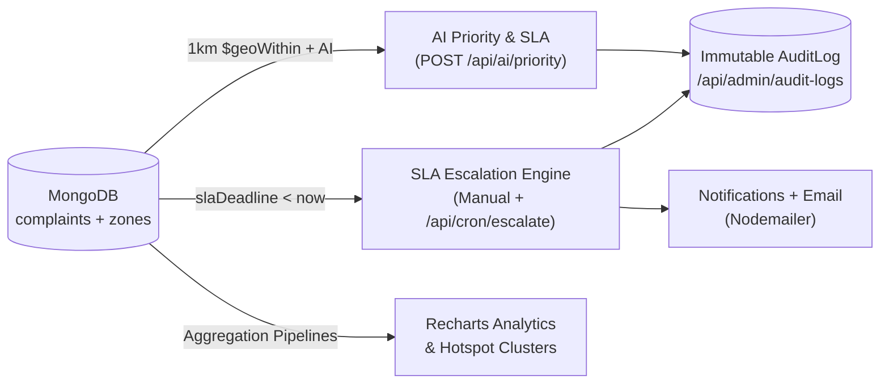

# Person 3 — Municipal Administration, SLA & Analytics (`CivicClean SWM`)

> **Owner**: Developer 3  
> **Workspace**: `Person-3-Administration-Analytics`  
> **Local URLs**: Frontend `http://localhost:5173` · Backend API `http://127.0.0.1:4003`  
> **Primary User Role**: `admin` (Municipal Administrator)

This workspace implements the **municipal governance, intelligence, and observability layer** of CivicClean SWM: command center KPIs, AI complaint priority estimation with safety rules & admin overrides, automated SLA escalation with Vercel Cron, real-time notifications & email alerts, Recharts analytics powered by MongoDB aggregations, geospatial hotspot clustering, immutable security audit logging, and CSV/JSON reporting.

---

## 1. Feature-by-Feature Guide (Access & Tech Stack)

| # | Feature | How to Access (UI Path & Role) | Backend API Endpoint(s) | Tech Stack & Implementation Details |
| --- | --- | --- | --- | --- |
| **1** | **Municipal Command Center** | Sign in as `admin` → **Sidebar → Admin Dashboard** (`/admin`). Displays system-wide KPIs (total, open, resolved, resolution rate %, avg response hours), user counts by role, active zones, and recent escalations. | `GET /api/admin/overview` | **React 19 + TypeScript**, **Tailwind CSS v4**, **MongoDB Aggregation Pipelines** (`User.aggregate`, `Complaint` metrics), **Express.js** RBAC (`authorize('admin')`). |
| **2** | **AI Complaint Priority Estimation & Override** | Click **Sidebar → Complaints Monitor** (`/complaints`). Click **"AI Priority"** on any complaint to compute severity (`low`/`medium`/`high`/`critical`), score (`0–100`), reasoning, and SLA deadline, or select a manual override with mandatory justification. | `POST /api/ai/priority`<br>`PATCH /api/admin/complaints/:id/priority` | **`@google/genai`** (`gemini-3-flash-preview`) + **Zod** validation, **MongoDB `$geoWithin` (`$centerSphere` 1 km density check)**, deterministic safety rules (hazardous/medical ≥ `high`, ≥5 nearby complaints boosts priority), dynamic SLA deadline computation (`6h`/`16h`/`48h`/`72h`), and audit logging. |
| **3** | **Real-Time Notifications & Email Hook** | Click **Sidebar → Notifications** (`/notifications`). View priority updates, escalations, and email delivery indicators with read-all controls. | `GET /api/notifications`<br>`PATCH /api/notifications/:id/read`<br>`PATCH /api/notifications/read-all` | **Nodemailer** HTML email dispatch (`SMTP_*`), optional **Firebase Realtime Database** REST push hook, **MongoDB (`notifications`)**. |
| **4** | **Automatic SLA Escalation & Cron Job** | Click **Sidebar → Escalations & SLA** (`/escalations`). Inspect overdue complaints past `slaDeadline`, review L1–L3 escalation history, or click **"Run Escalation Scan"** manually (also runs daily via Vercel Cron). | `GET /api/admin/escalations`<br>`POST /api/admin/escalations/run`<br>`GET /api/cron/escalate` | **Vercel Cron** (`vercel.json` + `api/cron/escalate.js` secured with `CRON_SECRET`), **6-hour anti-spam cooldown** (`lastEscalatedAt`), automatic priority bump (`low → medium → high → critical`), admin email alerts, **MongoDB (`escalations`)**. |
| **5** | **Municipal Analytics Dashboard** | Click **Sidebar → Analytics** (`/analytics`). Interactive charts for daily complaint trends, waste category breakdown, zone performance, fleet utilization, and worker workload. | `GET /api/analytics/summary`<br>`GET /api/analytics/trends`<br>`GET /api/analytics/zones`<br>`GET /api/analytics/categories`<br>`GET /api/analytics/fleet`<br>`GET /api/analytics/workers` | **Recharts v3** (`ResponsiveContainer`, `AreaChart`, `BarChart`, `PieChart`, `Tooltip`), backed by server-side **MongoDB Aggregation Pipelines** (`$match`, `$group`, `$lookup`, `$project`, `$sort`). |
| **6** | **Geospatial Hotspot Analysis** | Click **Sidebar → Geospatial Hotspots** (`/hotspots`). Visualizes high/medium/low complaint density clusters overlaid on municipal collection zones. | `GET /api/analytics/hotspots` | **Leaflet 1.9 + React-Leaflet v5** (`CircleMarker`, `Polygon`, `Popup`), server-side **spatial grid clustering** (`analyticsService.js`) grouping nearby coordinates into severity-weighted hotspot bubbles. |
| **7** | **Security & Immutable Audit Logs** | Click **Sidebar → Security & Audit** (`/audit`). Filter security & governance logs by action (`LOGIN_SUCCESS`, `LOGIN_FAILED`, `RBAC_DENIED`, `PRIORITY_OVERRIDDEN`, `ESCALATION_SCAN_EXECUTED`, `REPORT_EXPORTED`) and status. | `GET /api/admin/audit-logs` | **MongoDB (`auditLogs`)**, `auditService.js` capturing actor ID/role, IP address, request ID, resource type/ID, and JSON metadata; HTTP security headers (`X-Content-Type-Options`, `X-Frame-Options`) + API rate limiter. |
| **8** | **User Management & Report Exports** | Click **Sidebar → Users & Reports** (`/reports`). Activate/deactivate user accounts and download municipal operations reports in **CSV** or **JSON** format. | `GET /api/admin/users`<br>`PATCH /api/admin/users/:id/status`<br>`GET /api/admin/reports/export?format=csv\|json` | **Express.js** streaming CSV generator (`text/csv` attachment) & structured JSON export, audited automatically via `recordAudit()`. |

---

## 2. Core Tech Stack Summary

- **Frontend**: React 19, TypeScript 5.8, Vite, Tailwind CSS v4, React Router v7, Axios, **Recharts v3**, Leaflet + React-Leaflet v5, Lucide React
- **Backend**: Node.js (ESM), Express.js 4, Mongoose 8, Zod 3, **Nodemailer**, `bcryptjs`, `jsonwebtoken`, `cors`, `dotenv`
- **Database**: MongoDB (`complaints`, `escalations`, `notifications`, `auditLogs`, `users`, `collectionZones`, `vehicles`, `workers`)
- **AI & Automation**: `@google/genai` (priority estimation with deterministic guardrails), Vercel Hobby Daily Cron (`api/cron/escalate.js`)
- **Testing & Deployment**: Vitest + Supertest (`tests/person3.test.js`), Vercel Hobby Free-Plan serverless (`api/index.js` + `api/cron/escalate.js`)

---

## 3. Governance & Analytics Pipeline



---

## 4. Quick Start & Commands

```bash
cd Person-3-Administration-Analytics
cp .env.example .env       # Configure MONGODB_URI, JWT_SECRET, CRON_SECRET, optional GEMINI_API_KEY & SMTP_*
npm install
npm run dev                # Starts API (:4003) + Vite frontend (:5173) concurrently
```

### Verification Commands

```bash
npm run typecheck          # TypeScript strict check
npm run build              # Production bundle -> dist/
npm test                   # Vitest + Supertest integration suite (swm_p3_test)
```

---

## 5. Viva / Demo Walkthrough (2 Minutes)

1. Open **Admin Dashboard** (`/admin`) to walk through system KPIs and user distribution.
2. Open **Complaints Monitor** (`/complaints`), trigger **AI Priority** on a hazardous complaint to demonstrate AI scoring + safety guardrails, then perform a justified **Admin Priority Override**.
3. Open **Escalations & SLA** (`/escalations`) and click **Run Escalation Scan** to trigger an automatic SLA escalation & alert.
4. Show **Analytics** (`/analytics`) Recharts visualizations, **Geospatial Hotspots** (`/hotspots`) map clusters, **Security & Audit** (`/audit`) logs recording every action, and export a CSV report from **Users & Reports** (`/reports`).
